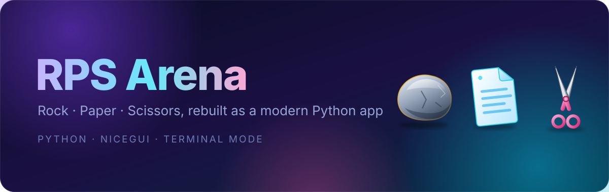
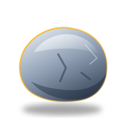
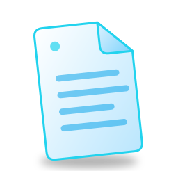
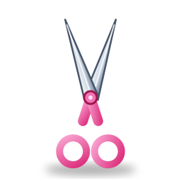

<div align="center">



**Rock, Paper, Scissors, rebuilt as a modern Python app.**
A glassy dark web interface powered by NiceGUI, plus a terminal mode for purists.


</div>

---

## Features

- **Modern web UI** with an animated gradient background, glass cards and smooth hover effects
- **Custom artwork:** hand-drawn SVG icons for rock, paper and scissors
- **Suspense:** the computer "thinks" for a moment before revealing its move
- **Live scoreboard**, win-streak tracking and a colour-coded trail of your last 8 rounds
- **Keyboard controls:** press `R`, `P` or `S`
- **Responsive:** works on desktop and phone screens
- **Terminal mode** for playing without a browser
- **Separate sessions:** every browser tab keeps its own score

| Rock | Paper | Scissors |
| :---: | :---: | :---: |
|  |  |  |

## Quick start

```bash
git clone https://github.com/active-X1/Rock-paper-scissors.git
cd Rock-paper-scissors

pip install -r requirements.txt     # installs NiceGUI
python run.py                       # opens http://localhost:8080
```

### Options

| Command | What it does |
| --- | --- |
| `python run.py` | Start the web app and open your browser |
| `python run.py --no-browser` | Start the web app without opening a tab |
| `python run.py --port 9000` | Use a different port |
| `python run.py --cli` | Play in the terminal (needs no extra packages) |

Prefer a proper install? `pip install .` adds an `rps-arena` command.

## How to play

Rock beats scissors, scissors beats paper, paper beats rock. Pick a card (or press
`R`, `P`, `S`) and see who wins. In terminal mode type `r`, `p` or `s`, and `q` to quit.

## Tech stack

| Technology | Used for |
| --- | --- |
| **Python 3.10+** | The whole application |
| **[NiceGUI](https://nicegui.io)** | Web interface, page routing, live updates, keyboard events |
| `random` | The computer's moves (seedable for tests) |
| `asyncio` | Non-blocking "thinking" delay |
| `enum`, `dataclasses` | `Move`, `Outcome` and `Round` types |
| `argparse` | Command-line options |
| `pathlib` | Locating bundled assets |
| `unittest` | Test suite (`pytest` also works) |
| CSS + SVG | Theme, animations and artwork (CSS lives in `web/styles.py`) |

## Project structure

```text
.
├── src/
│   └── rps_arena/
│       ├── __init__.py          # package metadata and version
│       ├── __main__.py          # python -m rps_arena
│       ├── cli.py               # options, terminal mode, launcher
│       ├── core/                # pure game logic, no UI imports
│       │   ├── moves.py         # Move, Outcome, judge()
│       │   └── game.py          # Game state: scores, streaks, history
│       ├── web/                 # NiceGUI front end
│       │   ├── app.py           # page layout, handlers, server start
│       │   └── styles.py        # all CSS
│       └── assets/              # SVG artwork and favicon
├── tests/                       # unit tests for logic, terminal mode, assets
├── docs/images/                 # README images
├── run.py                       # launcher that needs no installation
├── pyproject.toml
├── requirements.txt
├── requirements-dev.txt
└── LICENSE
```

The rule: **`core` never imports `web`**. The rules of the game are tested without a
browser, and both the web app and the terminal mode share the same engine.

## Development

```bash
pip install -r requirements-dev.txt
python -m unittest discover -s tests -v     # or: pytest
```

The core, terminal mode and asset checks need no NiceGUI at all, so they run anywhere.

## Roadmap

- [ ] Best-of-N match mode
- [ ] Optional smarter opponent that learns your habits
- [ ] Sound effects
- [ ] Add a real screenshot or GIF to this README

## License

Released under the [MIT License](LICENSE). Built by [Cyrus Akacha Cyprian](https://github.com/active-X1).
